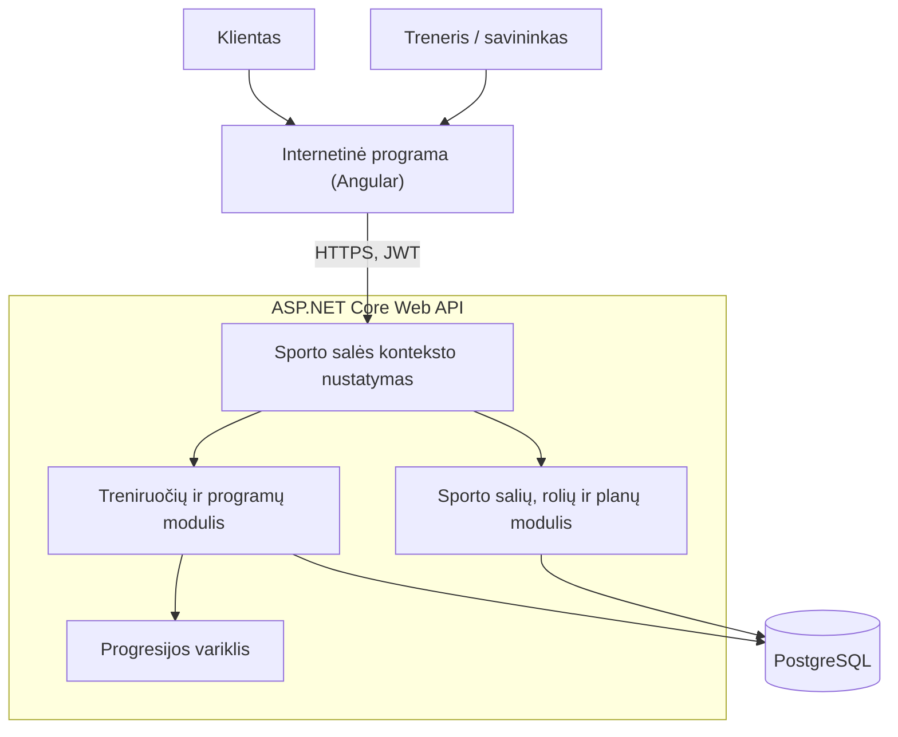

# Plates

## 1. Problema ir idėja

**Sistema vienu sakiniu:** „Plates“ – SaaS platforma sporto salėms ir treneriams, kuri pagal kliento atliktas treniruotes apskaičiuoja kitos treniruotės svorius ir pakartojimus.

**Problema ir dabartinis procesas:** darome prielaidą, kad treneriai programas siunčia skaičiuoklėmis ar žinutėmis ir krūvį kiekvienam klientui koreguoja rankiniu būdu. Klientai rezultatus rašo telefono užrašuose arba jų nefiksuoja (UX kurso apklausa: 2 iš 3 respondentų nenaudoja specialios programėlės), todėl neprisimena, kiek kėlė praeitą kartą.

**Nauda:** klientas mato šios dienos tikslus; treneris nebeskaičiuoja krūvio rankiniu būdu ir mato, kas stringa; sporto salė visus trenerius ir klientus valdo vienoje sistemoje.

**Naudotojai:** klientas (registruoja serijas, mato tikslus ir rekordus), treneris (kuria ir priskiria programas, stebi progresą), savininkas (kviečia trenerius ir klientus, valdo planą), platformos administratorius (valdo sporto salių paskyras ir planus).

**Prielaidos:**

- Klientų poreikiai (greitas įvedimas, nereikia prisiminti svorių) pagrįsti UX kurso apklausa (3 respondentai). Trenerių poreikiai yra prielaida – treneriai nebuvo apklausti.
- Kiekviena sporto salė ar savarankiškai dirbantis treneris turi atskirą paskyrą; jos duomenys nematomi kitoms sporto salėms.
- Kiekvienam klientui sporto salėje priskiriamas vienas treneris.
- Progresijos taisyklės remiasi plačiai naudojama dviguba progresija; treneris gali keisti jų parametrus konkrečiam pratimui.
- Prototipe mokėjimai nevykdomi – planą administratorius pakeičia rankiniu būdu.

## 2. Apimtis

| Funkcija | Ką naudotojas galės atlikti | Pagrindinis modulis ar pagalbinė funkcija |
| --- | --- | --- |
| Progresijos variklis | Apskaičiuoja kitos treniruotės tikslus, mažina krūvį po nesėkmių, nustato rekordus. | **Pagrindinis modulis** |
| Treniruočių registravimas | Klientas įveda serijas; pradinės reikšmės – variklio tikslai. | Pagalbinė |
| Programos | Treneris sukuria programą ir priskiria ją klientui. | Pagalbinė |
| Paskyros, rolės, kvietimai | Savininkas kviečia trenerius ir klientus nuoroda; duomenys atskirti pagal sporto salę. | Pagalbinė (SaaS) |
| Plano ribos | Negalima viršyti plano klientų skaičiaus (5, 30 arba neribotai). | Pagalbinė (SaaS) |

**Į kursinio darbo apimtį neįeina:** mokėjimai, lyderių lentelės, pranešimai ir el. laiškai, veikimas be ryšio, mobilioji programėlė, AI funkcijos.

## 3. Pagrindinis modulis

**Pavadinimas ir atsakomybė:** progresijos variklis – pagal atliktą treniruotę kiekvienam pratimui nustato kitos treniruotės svorį ir naujus rekordus. Taikoma dviguba progresija: pirma didinami pakartojimai, pasiekus intervalo viršų – svoris. Kiekvienas sprendimas turi priežasties kodą.

**Logika, kurią reikės projektuoti ir testuoti:** serijų įvertinimas, sprendimas didinti, išlaikyti ar mažinti krūvį, nesėkmių skaičiavimas, apvalinimas, 1RM pagal Epley formulę.

**Įvestis:** programos parametrai (serijos, pakartojimų intervalas, pradinis svoris, prieaugis, mažinimo dydis – 10 %, nesėkmių riba – 2), kliento būsena (tikslas, nesėkmių skaitiklis – kiek treniruočių iš eilės buvo nesėkmingos, rekordas) ir atliktos serijos. Priskyrus programą, tikslas = pradinis svoris, nesėkmių skaitiklis = 0, rekordo nėra. Pavyzdys – 1 scenarijus.

**Išvestis:** kitas tikslas, sprendimo kodas (DIDINTI, RIBA, IŠLAIKYTI, NESĖKMĖ, MAŽINTI), nesėkmių skaitiklis ir naujas rekordas. Pavyzdys – 1 scenarijus.

**Veikimo eiga:** įvesties tikrinimas (klaida – atmetama visa treniruotė) → sprendimo taisyklė kiekvienam pratimui → apvalinimas ir rekordai → išsaugojimas vienoje transakcijoje → nauji tikslai su kodais.

### Taisyklės

1. **Įvesties tikrinimas.** 1–50 pakartojimų, 0–500 kg (0,5 kg tikslumu), pratimas yra programoje, data ne ateityje; kitaip atmetama visa treniruotė.
2. **Bazinis svoris** – mažiausias serijos svoris.
3. **Didinimas.** Atliktos visos serijos ir visose pasiektas intervalo maksimumas → tikslas = bazinis svoris + prieaugis, nesėkmių skaitiklis = 0. Jei tikslas viršytų 500 kg (1 taisyklės ribą), tikslas = 500 kg, o sprendimo kodas – RIBA: treneris mato, kad automatinė progresija sustojo.
4. **Išlaikymas.** Atliktos visos serijos, visose pasiektas minimumas, bet ne visose maksimumas → tikslas = bazinis svoris, nesėkmių skaitiklis = 0.
5. **Mažinimas.** Bent vienoje serijoje nepasiektas minimumas arba atlikta mažiau serijų → nesėkmių skaitiklis + 1. Pasiekus ribą → tikslas = bazinis svoris, sumažintas mažinimo dydžiu, nesėkmių skaitiklis = 0 (MAŽINTI); kitaip tikslas = bazinis svoris (NESĖKMĖ).
6. **Apvalinimas** žemyn iki 2,5 kg kartotinio (dviejų 1,25 kg diskų žingsnis); todėl kuriant programą tikrinama, ar prieaugis yra 2,5 kg kartotinis.
7. **Rekordas.** Kai pakartojimų ≤ 12: 1RM = svoris × (1 + pakartojimai / 30), o kai 1 pakartojimas – 1RM = svoris; apvalinama iki 0,1 kg. Naujas rekordas, jei jo nebuvo arba 1RM didesnis.

### Scenarijai būsimiems testams

| Scenarijus | Pradinės sąlygos ir konkreti įvestis | Veiksmas | Tikslus laukiamas rezultatas |
| --- | --- | --- | --- |
| Įprastas atvejis | Pritūpimas 3 × 5–8, prieaugis 5 kg; tikslas 60 kg, nesėkmių skaitiklis 0, rekordas 72,0 kg. Atlikta 60 × 8, 60 × 8, 60 × 8. | Užbaigia treniruotę | 65 kg; DIDINTI; nesėkmių skaitiklis 0; rekordas 76,0 kg. |
| Ribinis atvejis | Tas pats; tikslas 60 kg, rekordas 76,0 kg. Atlikta 60 × 8, 60 × 8, 60 × 6. | Užbaigia treniruotę | 60 kg; IŠLAIKYTI; nesėkmių skaitiklis 0; rekordas nepakinta. |
| Ribinis atvejis: svorio riba | Pritūpimas 3 × 5–8, prieaugis 5 kg; tikslas 500 kg, nesėkmių skaitiklis 0, rekordas 600,0 kg. Atlikta 500 × 8, 500 × 8, 500 × 8. | Užbaigia treniruotę | 500 kg (505 kg viršytų ribą); RIBA; nesėkmių skaitiklis 0; naujas rekordas 633,3 kg. |
| Konfliktas | Spaudimas gulint 3 × 6–10, prieaugis 2,5 kg; tikslas 47,5 kg, nesėkmių skaitiklis 1, rekordas 60,0 kg. Atlikta 47,5 × 7, 47,5 × 5, 47,5 × 4. | Užbaigia treniruotę | 42,5 kg (42,75 → 42,5); MAŽINTI; nesėkmių skaitiklis 0; rekordas nepakinta. |
| Klaida | Pritūpimas, tikslas 60 kg. Atlikta 60 × 8, 1000 × 8, 60 × 8. | Užbaigia treniruotę | Atmetama su klaida „2-osios serijos svoris 1000 kg viršija 500 kg ribą“; niekas nepakinta. |

**Jei modulis naudoja AI:** Netaikoma.

## 4. Kokybės atributas

**Pasirinktas atributas:** modifikuojamumas – naują progresijos schemą galima pridėti nekeičiant esamų.

**Kodėl svarbus šiai sistemai:** treneriai naudoja ir kitas schemas (piramides, sunkiausią seriją su lengvesnėmis, RPE), o visos sporto salės naudoja tą patį kodą, todėl nauja schema neturi keisti esamų elgsenos.

**Tikrinimo scenarijus ir sąlygos:** pridedama schema „Sunkiausia serija ir lengvesnės serijos“: 1 serija – 3–5 pakartojimai, 2 serijos – 85 % jos svorio, 8–10 pakartojimų; svoris didinamas, kai pirmojoje serijoje atliekami 5 pakartojimai. Tikrinamas variklis ir API, be „Angular“ formų.

**Sėkmės kriterijus:** esamos klasės nekeičiamos (tik nauji failai ir viena registracijos eilutė); visi ankstesni testai praeina; naujai schemai bent 3 testai praeina; duomenų bazės schemos keisti nereikia.

**Numatytas projektavimo sprendimas:** strategijos šablonas – sąsaja `IProgressionScheme`, bendros taisyklės (1, 6, 7) atskirose klasėse, schemos registruojamos per priklausomybių injekciją; schemos parametrai ir būsena saugomi JSON laukuose.

**Kaip patikrinsiu vėlesniame etape:** nauja schema atskiroje „Git“ šakoje, `git diff` ir testų rezultatai.

**Sprendimo kaina arba ribojimas:** daugiau klasių; JSON reikia tikrinti kode; bendrų taisyklių pakeitimas paveikia visas schemas.

## 5. Pradinė sistemos struktūra

### Paprasta schema

| Sistemos dalis | Atsakomybė |
| --- | --- |
| Internetinė programa („Angular“) | Sąsaja pagal naudotojo rolę. |
| Sporto salės konteksto nustatymas | Naudotojas, rolė ir sporto salė nustatomi tik iš JWT. |
| Treniruočių ir programų modulis | Saugo duomenis, kviečia variklį, rezultatą išsaugo vienoje transakcijoje. |
| Progresijos variklis | Pagrindinė logika; C# biblioteka be duomenų bazės ir HTTP priklausomybių. |
| Sporto salių, rolių ir planų modulis | Paskyros, kvietimai, plano ribos. |
| PostgreSQL | Visų sporto salių duomenys, atskirti pagal `TenantId`. |

**Planuojamos technologijos ir pasirinkimo priežastys:** C# ir .NET 10 (LTS); ASP.NET Core Web API ir Identity (priklausomybių injekcija, middleware, JWT); Entity Framework Core (globalūs filtrai pagal sporto salę); PostgreSQL (`jsonb` schemų parametrams); „Angular“ (turiu patirties; TypeScript klientas generuojamas iš OpenAPI su NSwag); xUnit (testai); Docker Compose (vienoda aplinka).

## 6. AI panaudojimas

### AI rengiant šį dokumentą

Rengiant dokumentą naudotas „Claude“ (Anthropic). Galutinius sprendimus priėmiau pats.

| Priemonė ir užduotis | Ką panaudojau | Ką atmečiau arba perrašiau ir kodėl | Kaip patikrinau |
| --- | --- | --- | --- |
| „Claude“: idėja, apimtis, technologijos | SaaS modelį (sporto salė – atskira paskyra), sistemos dalis ir .NET technologijas. | Alternatyvių idėjų atsisakiau, kad tęsčiau išanalizuotą sritį; „Blazor“ pakeičiau „Angular“, nes turiu jo patirties. | Palyginau su užduoties reikalavimais ir alternatyvomis. |
| „Claude“: taisyklės, scenarijai, kokybės atributas | Dvigubos progresijos taisykles, scenarijus, modifikuojamumo scenarijų ir strategijos šabloną. | Po peržiūros su AI patikslinau taisykles; greičio ir kainos atributų atsisakiau; „skaitiklį“ pakeičiau „nesėkmių skaitikliu“. | Klausimais įsitikinau, kad galiu paaiškinti taisykles ir atributo patikrinimą. |
| „Claude“: teksto rašymas | Skyrių juodraščius. | Perrašiau netaisyklingas frazes, pašalinau perteklinę informaciją. | Perskaičiau ir pataisiau tekstą. |

### Planuojamas AI naudojimas kuriant sistemą

**Kur ir kam naudosiu AI:** didžiąją dalį kodo generuos AI agentas (pvz., „Claude Code“); aš rašau specifikacijas, peržiūriu ir dalį kodo rašau pats. Modulio taisykles ir scenarijus nustatau aš.

**Kaip tikrinsiu pasiūlymus ir sugeneruotą kodą:** 3 skyriaus scenarijai tampa testais prieš variklio kodą, o AI negali jų keisti be mano sutikimo; kiekvienas pakeitimas – atskira šaka ir „pull request“, nesuprasto kodo nesujungiu; prieš sujungiant testai paleidžiami lokaliai (ateityje – „GitHub Actions“); tikrinu autorizaciją, sporto salės filtrą ir AI pasiūlytų paketų egzistavimą. Pagrindinės rizikos – subtilios klaidos ir pasenusios ar neegzistuojančios bibliotekos.

**Ar AI bus sistemos funkcionalumo dalis:** ne – taisyklės deterministinės, kad rezultatus būtų galima tiksliai testuoti.

## 7. Tolesnių darbų planas

| Darbas | Apčiuopiamas rezultatas | Planuojama darbų seka |
| --- | --- | --- |
| Karkasas ir aplinka | .NET, „Angular“, „Docker Compose“ su PostgreSQL; `docker compose up` paleidžia sistemą. | 1 |
| Progresijos variklis | Scenarijai kaip xUnit testai, tada 1–7 taisyklės; testai praeina. | 2 (lygiagrečiai su 3) |
| Paskyros ir prisijungimas | JWT, kvietimai, sporto salės filtrai, plano ribos; izoliacijos testas. | 3 |
| Programos ir treniruotės | API ir „Angular“ puslapiai, sujungti su varikliu. | 4 |
| Demonstracija | Demonstraciniai duomenys; nauja schema atskiroje šakoje. | 5 |

**Būsimo prototipo veikimo scenarijus:** demonstraciniuose duomenyse klientui priskirta programa (pritūpimas 3 × 5–8, prieaugis 5 kg; spaudimas gulint 3 × 6–10, prieaugis 2,5 kg) ir viena atlikta treniruotė (pritūpimas 60 × 7, 6, 6 – rekordas 74,0 kg; spaudimas gulint 47,5 × 7, 5, 4 – NESĖKMĖ, nesėkmių skaitiklis 1, rekordas 58,6 kg). Klientas mato tikslus 60 kg ir 47,5 kg, įveda pritūpimą 60 × 8, 8, 8 ir spaudimą gulint 47,5 × 7, 5, 4. Laukiama: pritūpimas – 65 kg (DIDINTI), rekordas 76,0 kg; spaudimas gulint – 42,5 kg (MAŽINTI); treneris mato abu sprendimus su priežastimis. Serija su 1000 kg svoriu atmetama.

| Rizika arba neaiškumas | Kaip patikrinsiu arba sumažinsiu |
| --- | --- |
| AI sugeneruoto kodo klaidos | Testai prieš kodą, mažos užduotys, peržiūra. |
| Praleistas sporto salės filtras | Izoliacijos testas kiekvienam API taškui prieš sujungimą. |
| Taisyklės neatitinka trenerių poreikių (treneriai neapklausti) | Parametrai keičiami pratimui; naujos schemos pridedamos nekeičiant esamų. |

## Šaltiniai

1. Naudotojų apklausa, atlikta rengiant „Žmogaus ir kompiuterio sąveikos“ kurso 1 laboratorinį darbą „Plates“: 3 respondentai (20–21 m.), 7 klausimai apie treniruočių rezultatų fiksavimą ir programėlių naudojimą, 2026 m. rugsėjis.
2. „Claude“ (Anthropic) – pokalbis rengiant šį dokumentą, 2026 m. spalis. Naudojimas aprašytas 6 skyriuje.
